<p align="center">
  
</p>

<h1 align="center">Briefcast</h1>

<p align="center">
  Pick what you follow and a time. Every day at that time an agent researches it from fresh
  sources, writes a five-minute script, voices it with <b>Gnani.ai</b> and emails you the episode.
</p>

<p align="center">
  <a href="https://briefcast.hayyan.space"><b>briefcast.hayyan.space</b></a>
  · press play on the home page to hear two real episodes, in English and Hindi
</p>

<picture>
  <source media="(prefers-color-scheme: dark)" srcset="docs/screenshots/dashboard-dark.jpg">
  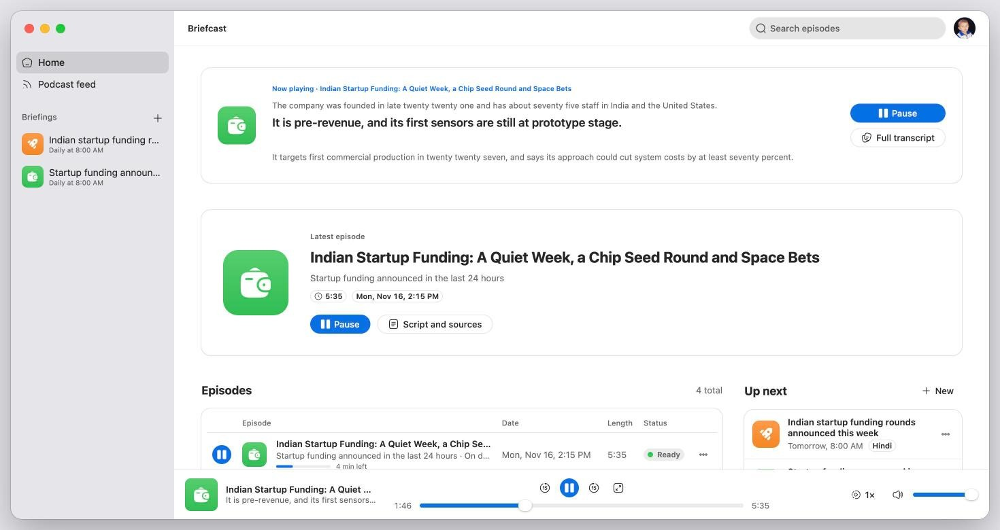
</picture>

> Example: *"Startup funding announced in the last 24 hours"*, every day at 8:00 AM, in Hindi.

## What it does

| | |
| --- | --- |
| **Follow anything.** Browse 15 categories or type any interest, mix up to six into one daily episode, and pick the region, freshness, time, language and voice. | 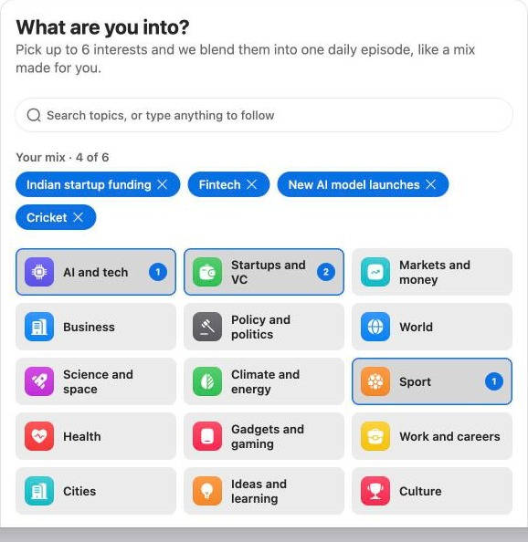 |
| **Research you can check.** A bounded agent searches the web, reads the key articles in full and cites every claim. Its log shows what it searched, what it read and what it could not verify. | 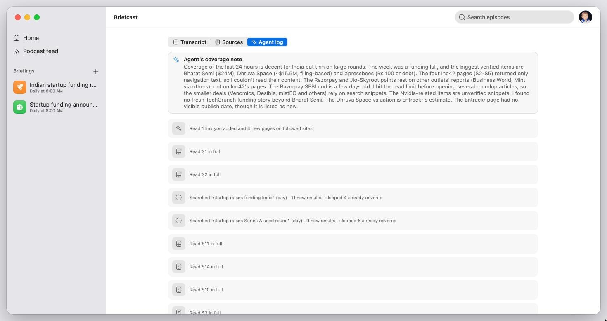 |
| **Listen your way.** In the browser with a lyrics-style transcript that follows the voice, by email the moment an episode is ready, or in any podcast app through a private feed. | 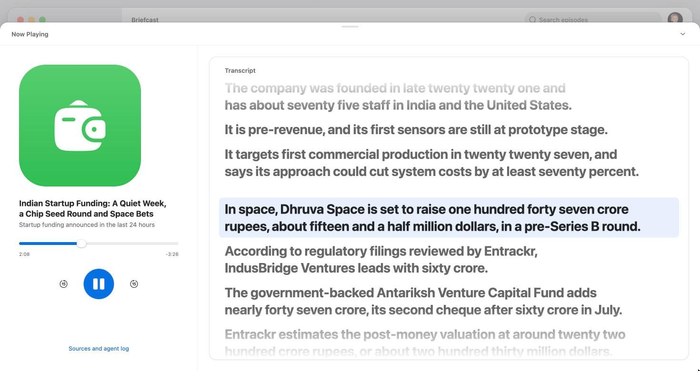 |
| **11 languages.** English, Hinglish, Hindi, Tamil, Telugu, Kannada, Malayalam, Marathi, Bengali, Gujarati and Punjabi, with Gnani.ai Timbre voices and a sample for each voice. | 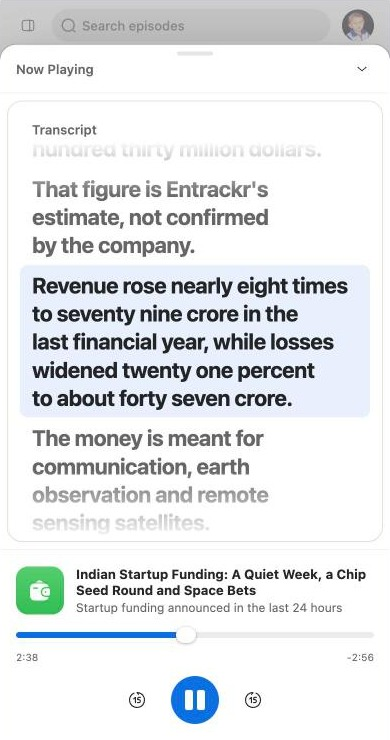 |

<details>
<summary>More screenshots</summary>

| Sources | Onboarding: sources and schedule | Email |
| --- | --- | --- |
| 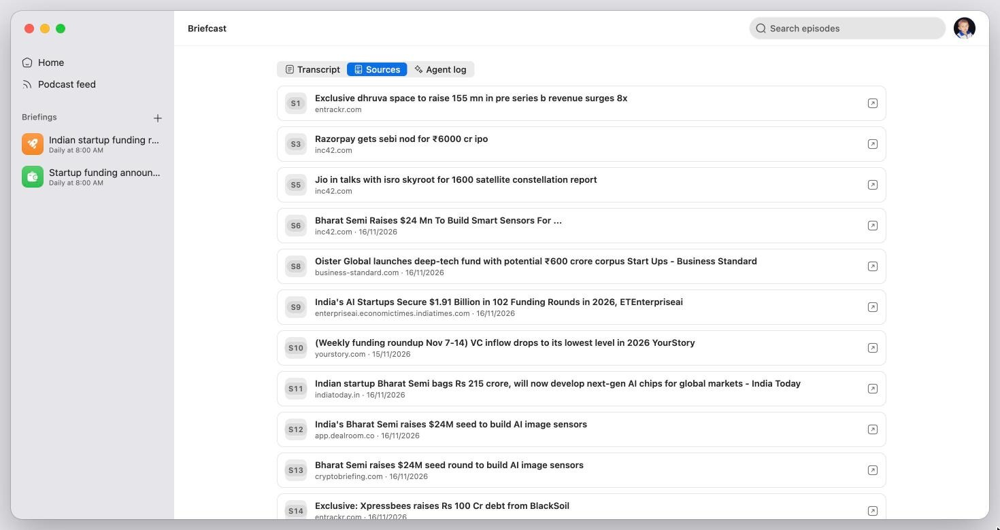 | 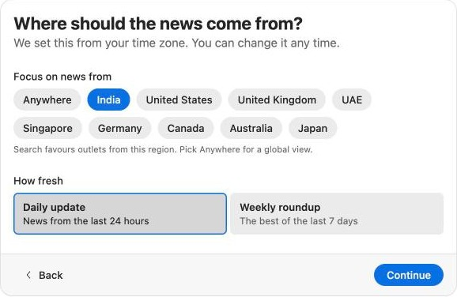<br>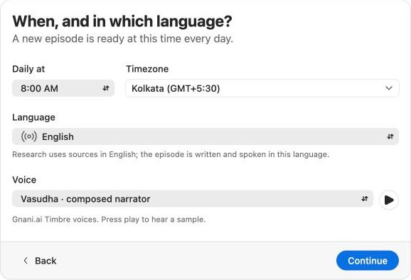 | 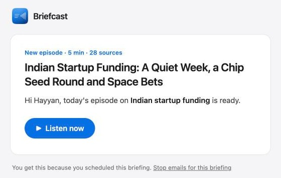 |

| Phone | Dark mode |
| --- | --- |
| 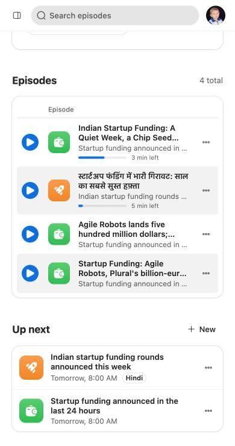 | 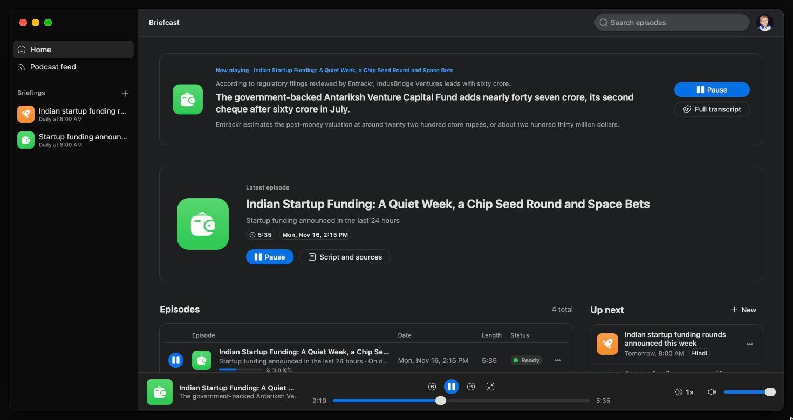 |

</details>

## Architecture

```
 Browser ──► Next.js (web) ──────────────► FastAPI (api) ──► Postgres
   │          Auth.js Google sign-in          │  ▲
   │          /api/backend/* proxy            │  │ enqueue
   │          (session cookie → 5-min JWT)    ▼  │
   │                                        Redis (ARQ)
   │                                           │
   │                                           ▼
   │                                     ARQ worker
   │                          ┌── cron every minute: find due briefings
   │                          └── generate_episode job:
   │                                research agent ── Tavily search/extract
   │                                script writer   ── LLM via OpenRouter
   │                                TTS             ── Gnani.ai Timbre
   │                                align + store   ── ffmpeg, Postgres
   └──── email link ◄──────────────  mailer        ── SMTP
```

| Service | Role |
| --- | --- |
| `web` | Next.js 16 with shadcn/ui and CupertinoUI. Google sign-in (Auth.js). The only public service. |
| `api` | FastAPI. Briefings and episodes, audio streaming with Range support, the podcast feed. |
| `worker` | ARQ worker. Runs the per-minute scheduler and the episode pipeline. |
| `postgres` | Users, briefings, episodes, MP3 audio, voice samples. |
| `redis` | ARQ job queue. |

### Auth and data isolation

Google sign-in happens in Next.js; the browser only ever holds the Auth.js session cookie.
Every API call goes through `/api/backend/*`, a route handler that reads the session and
forwards the request to FastAPI with a 5-minute HS256 token (`BACKEND_JWT_SECRET`). FastAPI
verifies issuer, audience and expiry, upserts the user by email, and **every query filters by
`user_id`**, so another user's briefing or episode is a 404, not a 403. The API is never
exposed to the internet. Podcast feeds and email unsubscribe links use their own unguessable
tokens (the feed token can be rotated; unsubscribe links are HMAC-signed).

### Scheduling

A briefing stores wall-clock time plus an IANA timezone (`08:00`, `Asia/Kolkata`) and a
precomputed `next_run_at` in UTC, so 8:00 stays 8:00 across DST changes.

Every minute an ARQ cron job (`unique=True`, so only one worker runs it):

1. selects due briefings with `FOR UPDATE SKIP LOCKED`;
2. inserts one episode per briefing per slot. A unique constraint on
   `(briefing_id, scheduled_for)` makes double scheduling impossible;
3. advances `next_run_at` past now, so missed slots collapse into one catch-up episode;
4. commits, then enqueues `generate_episode` with job id `episode:<id>`. ARQ refuses a
   duplicate job id, so re-enqueueing is always safe;
5. recovers episodes that were committed but never enqueued, or whose worker died.

### The research agent

`app/agent/research.py` is a bounded tool-calling loop (at most 14 steps and 6 full reads):

- `search_web(query, recency, kind)`: Tavily search, recency `day` by default.
- `read_source(source_id)`: Tavily extract, for exact figures and names.
- `finish_research(findings[], coverage_note)`: every finding must cite source ids.

Every result is registered as `S1, S2, …`, and findings that cite unknown ids are dropped,
so the script can only use sources the agent really retrieved. Web text is wrapped as
untrusted data, and the prompt tells the model never to follow instructions inside it.

Before the loop, `app/agent/context.py` gathers what the briefing asks for:

- **Memory:** stories covered in the last 7 days are skipped unless there is news on them.
- **Source controls:** trusted sites get their own restricted search; blocked sites are
  filtered out; a region favours local outlets.
- **Followed sites and added links:** new articles on followed pages (listing pages are
  filtered out) and links the user queued are read first.

Source titles are cleaned of page boilerplate ("Skip to content", markdown links), with a
readable fallback from the URL.

### Script and voice

`app/agent/script.py` turns the findings into a spoken script of about 750 words (≈ 5
minutes; 80% of that for Indian languages, which are spoken more slowly), with numbers and
money written out as words for the voice. If the length misses the 85–120% window, the model
gets one revision pass.

Gnani's REST TTS takes one text per request, rejects over-long text and allows one active
request per account. `app/tts.py` splits the script on sentence boundaries (including the
Devanagari danda) into chunks of up to 450 characters, synthesises them one at a time, retries
429/5xx with backoff, halves a chunk that keeps failing, joins the audio with short pauses
and encodes MP3 with ffmpeg.

### Synced transcript

Each chunk's start and end come from the exact audio length synthesised so far, but
sentence times inside a chunk can only be estimated. `app/align.py` then runs ffmpeg
`silencedetect` on the finished MP3 and moves each sentence's start to the nearest real
pause. On a real episode that took the highlight from up to 3 seconds off the voice to within
about a tenth of a second. Older episodes are aligned once, on first open. In the browser the current line
is tracked every animation frame, not on the 4-per-second `timeupdate` event.

### Reliability

Each pipeline stage saves its output: a retried job skips research if the script exists and
skips TTS if the audio exists. Transient failures retry up to 3 times with backoff; bad Gnani
credentials or no credit fail fast. Failed episodes show the error and a Retry button.

## Frontend

Next.js 16 (App Router, Cache Components) with **shadcn/ui on Base UI**, styled with the
[CupertinoUI](https://www.cupertino-ui.com/) macOS theme: the signed-in app is a macOS window
with a source-list sidebar, toolbar search, system colors and icon tiles.

- **Light and dark** (System, Light or Dark in the account menu) on the macOS palettes. A
  few tokens are adjusted so every visible label meets WCAG AA in both themes.
- **Same on every OS:** in-app time and searchable timezone pickers instead of native inputs,
  and Inter as the fallback for San Francisco on Windows, Android and Linux.
- **Onboarding** in five steps: interests (browse, search or type your own), sources, schedule
  with voice samples, review, then the first episode is made straight away.
- **Player:** one `<audio>` element in a React context, so playback continues across pages,
  with a live caption, a Now Playing sheet with the lyrics-style transcript, ±15 s, speed,
  the Media Session API (lock screen and media keys) and resume where you left off.
- **Phones:** the transcript gets the screen in Now Playing, and inputs avoid iOS zoom.
- **Landing page:** a playable sample episode in English and Hindi with its synced transcript.
- All motion respects `prefers-reduced-motion`.

## Running locally

```bash
docker compose -f docker-compose.dev.yml up -d        # Postgres :5442, Redis :6392

cd backend
cp ../.env.example .env   # fill in keys; DATABASE_URL/REDIS_URL for the dev ports
uv sync
uv run alembic upgrade head
uv run uvicorn app.main:app --reload                   # API on :8000
uv run arq app.worker.WorkerSettings                   # worker
uv run pytest                                          # tests

cd ../frontend
npm install
npm run dev                                            # http://localhost:3000
```

ffmpeg must be on the `PATH` for the worker. Google OAuth redirect URI:
`<APP_URL>/api/auth/callback/google`.

## Deploying

`docker compose up -d --build` with a filled `.env` (see `.env.example`). Only `web`
(port 3000) needs a domain. Episode emails are sent through any SMTP service set in `SMTP_*`
and `MAIL_FROM`.

## Credits

- Voices: [Gnani.ai](https://gnani.ai) Timbre TTS. Research: [Tavily](https://tavily.com).
- macOS components and theme: [CupertinoUI](https://www.cupertino-ui.com/) (MIT).
- Icons: Solar by 480 Design (CC BY 4.0), via [`@solar-icons/react`](https://www.npmjs.com/package/@solar-icons/react) (MIT).
- Early layout ideas from the Figma Community file *Free Podcast Player Web Design*.
